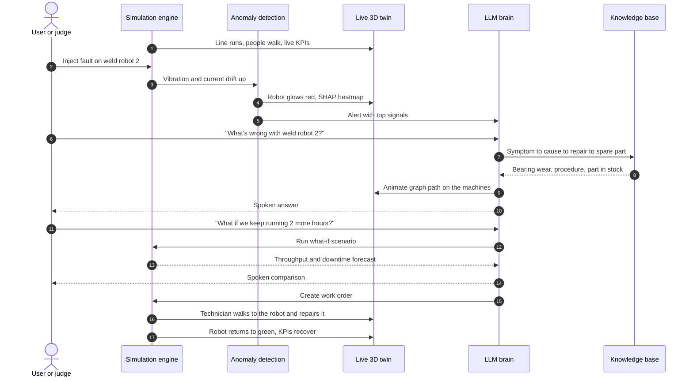

# Talk to Your Plant: Digital Twin

A live 3D digital twin of a fictional EV assembly plant, with animated machines and people. A simulation engine drives it, and an AI copilot (LLM + knowledge-graph RAG) lets you ask what is wrong, why, and what happens if something changes.

Status: early scaffolding. See [docs/STATIONS.md](docs/STATIONS.md), [docs/ASSETS.md](docs/ASSETS.md), [DECISIONS.md](DECISIONS.md) and [CLAUDE.md](CLAUDE.md).

## System flow

Blue is the twin/simulation side (this repo). Green is the knowledge/LLM side. Grey is shared.

```mermaid
flowchart LR
  SYN["Synthetic data generator"]

  subgraph D1["Data 1: plant operations"]
    direction TB
    LAY["Layout"]
    EMP["Employees and shifts"]
    SEN["Sensor time series"]
    TIM["Timing and cycle times"]
  end

  subgraph D2["Data 2: plant knowledge"]
    direction TB
    MLOG["Maintenance logs"]
    SLOG["Service logs"]
    PROC["Company procedures and protocols"]
  end

  SYN --> D1
  SYN --> D2

  SIM["Simulation engine"]
  WIF["What-if scenarios"]
  AD["Anomaly detection and SHAP"]
  KB[("Knowledge base: graph and vector RAG")]
  LLM{{"LLM brain"}}

  D1 --> SIM
  SIM --> WIF
  WIF <-->|"scenario params and results"| LLM
  SIM -->|"sensor stream"| AD
  AD -->|"alert and explanation"| LLM
  D2 --> KB
  KB -->|"retrieved context and graph path"| LLM

  subgraph UI["What the user sees"]
    direction TB
    DASH["Dashboard: KPIs, throughput, forecast"]
    TWIN["Live 3D window"]
    CHAT["Chat interface: voice, photo, text"]
  end

  SIM --> DASH
  SIM -->|"machine and people state"| TWIN
  AD -->|"red glow and heatmap"| TWIN
  LLM -->|"graph path highlight"| TWIN
  CHAT -->|"user input"| LLM
  LLM -->|"answer"| CHAT
  LLM -->|"work order"| SIM

  classDef twin fill:#dbeafe,stroke:#1d4ed8,color:#0f172a
  classDef brain fill:#dcfce7,stroke:#15803d,color:#0f172a
  classDef shared fill:#e5e7eb,stroke:#4b5563,color:#0f172a
  class LAY,EMP,SEN,TIM,SIM,WIF,DASH,TWIN twin
  class MLOG,SLOG,PROC,KB,LLM,CHAT brain
  class SYN,AD shared
```

What is new versus the first idea: the simulation engine sits at the center and produces everything the twin shows, and the LLM can both explain faults and run what-if scenarios. The work order loops back into the simulation, so a technician agent walks to the machine and the fault clears.

## Hero scenario (90 seconds)

## Credits

Third-party assets are listed with licences in [docs/ASSETS.md](docs/ASSETS.md).
