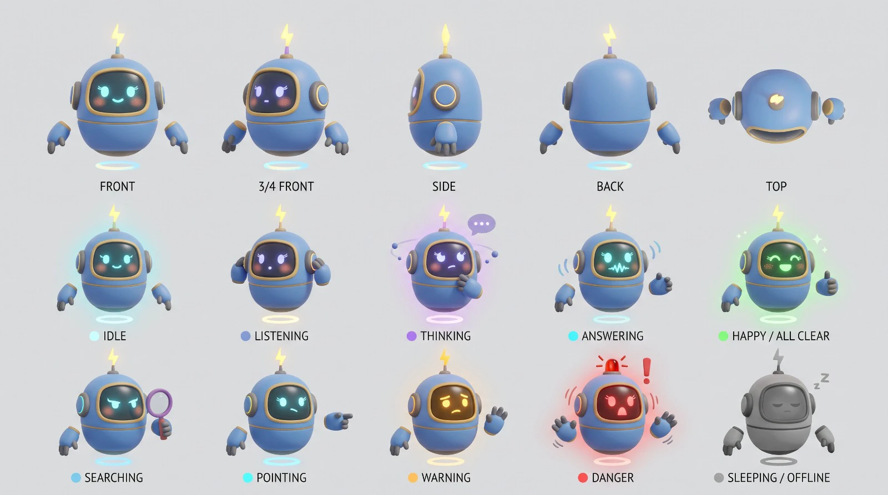

# Volty, the plant assistant

A small floating robot at the top of the chat. Built in code from primitives (`twin/src/ui/Volty.tsx`, no model files): egg shell, gold face bezel with a canvas-texture face, ear discs with glowing rims, floating hands, antenna with a lightning bolt (a siren in danger) and a hover ring. See every state at once with `http://localhost:5180/?botdemo=1`.

## States and what triggers them

| State | Look | Trigger |
|---|---|---|
| ready | cyan smile, slow sway, blink | default |
| listening | ring eyes, head tilt, hand at ear | typing a question |
| thinking | violet, orbiting dots, "..." bubble, hand on chin | question sent |
| searching | magnifier, narrowed eyes | question about a part, stock, procedure, "who", "where", "which" |
| answering | waveform mouth, talking pulse, gesturing | normal answer (3.5 s) |
| all clear | green, happy eyes, sparkles, thumbs up | answer with severity ok (4 s) |
| look here | points sideways | the graph path is shown on the plant (4.5 s) |
| warning | amber glow, worried brows, blinking antenna | answer with severity warning (12 s) |
| danger | red body tint, siren and "!", shaking, hands up, red pulsing chat border | answer with severity critical (20 s) |
| offline | grey, eyes closed, "z z" | the brain is not reachable |

The chat panel itself takes on the mood (red pulsing border in danger, amber in warning, violet while thinking). State lives in the store (`bot`, `setBot(state, holdMs)`), so any part of the UI can drive it.

## Prompt used to generate the character sheet (Gemini)

The sheet has five turnaround views and ten state panels; the master prompt is in the project chat history. Palette: shell `#6f93d8`, gold trim `#c9a45c`, face glass `#0b1220`, glows cyan `#5ee7f2`, violet `#a78bfa`, green `#4ade80`, amber `#fbbf24`, red `#ff4d4d`.
